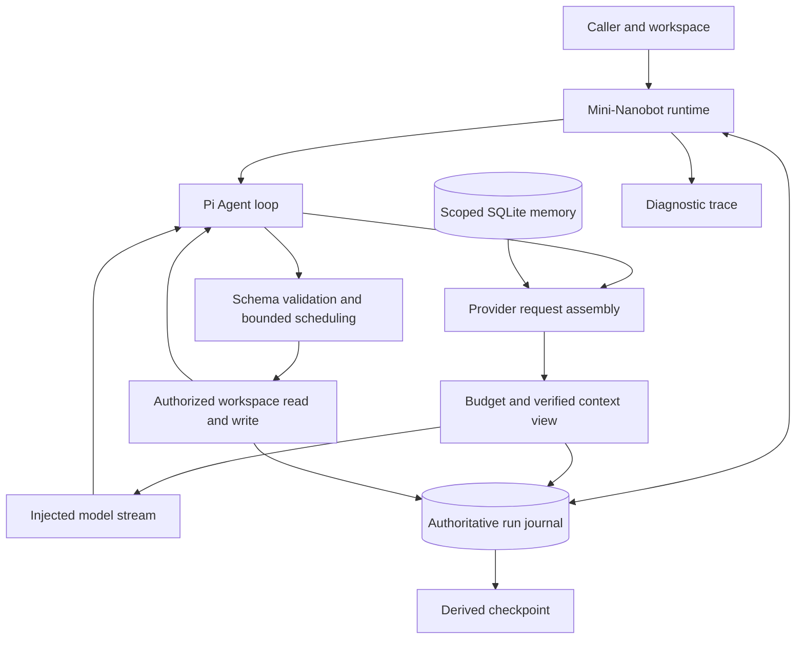

# Mini-Nanobot architecture

The Python Pi agent remains the model and tool loop. Mini-Nanobot adds policy and persistence at the boundaries where Pi assembles requests and invokes tools.

| Authority | Contents and recovery role |
| --- | --- |
| Pi transcript | Full in-memory message sequence. The provider can receive a verified compacted view. |
| JSONL run journal | Durable model replies, authorized tool transitions and results, memory revision dependencies, and active compaction commits. |
| Checkpoint | Derived cache validated against the journal's sequence, checksums, and state digest. |
| SQLite memory | Scoped revisions, provenance, invalidation and tombstones checked at context assembly. |
| Diagnostic trace | Attempt-level metadata for verification. Run recovery uses the journal. |

Reads can overlap in bounded batches. Writes drain the read batch and run alone. A started write with no durable result blocks recovery and returns the affected call IDs. Revocation can invalidate a previous model turn that echoed a removed memory revision. Compaction preserves the original user instruction and all write turns.

Implementation details are in the [recovery contract](recovery-invariants.md), [tool policy](tool-policy.md), [memory lifecycle](memory-lifecycle.md), and [context budget](context-budget.md).
